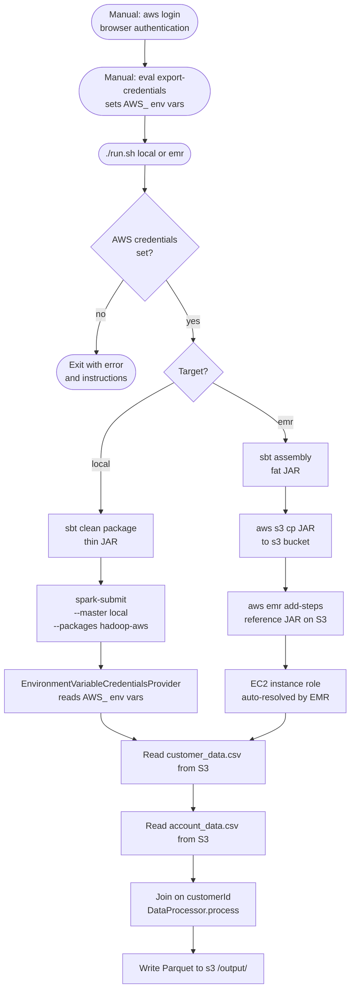

# Requirements

## What it does

Reads customer and account CSVs from S3, joins them, and writes the result as Parquet back to S3.

## Flow




The pipeline can be run locally or on AWS EMR, controlled by a shell script.

```
./run.sh local
./run.sh emr
```

## Shell script behaviour

| Step | Local | EMR |
|------|-------|-----|
| Build | `sbt clean package` | `sbt assembly` |
| Upload JAR | — | `aws s3 cp` to `s3://<bucket>/jars/` |
| Run | `spark-submit --master local[*] --packages org.apache.hadoop:hadoop-aws:3.3.4` | `aws emr add-steps` |

> Local uses a thin JAR. `hadoop-aws` is not bundled — it is resolved at runtime via `--packages`.
> EMR uses a fat JAR (assembly) because the JAR is uploaded to S3 and must be self-contained.

## spark-submit arguments

- `--class Main`
- positional args: `<bucket>` `<region>`

## Credentials

**Local:**
- Login via `aws login` (AWS SSO/Identity Center)
- After login, export temporary credentials as environment variables:
  ```bash
  eval "$(aws configure export-credentials --profile default --format env)"
  ```
- This sets `AWS_ACCESS_KEY_ID`, `AWS_SECRET_ACCESS_KEY`, and `AWS_SESSION_TOKEN` which Spark's `EnvironmentVariableCredentialsProvider` reads automatically
- Verify with: `aws sts get-caller-identity`

**EMR:**
- IAM instance profile attached to the cluster — no env vars or manual login needed

## EMR provisioning

Done manually via AWS console. The script assumes a running cluster and reads the cluster ID from an environment variable `EMR_CLUSTER_ID`.

## Dependency management

- `spark-sql` is marked `provided` in `build.sbt` — it must not be bundled as the cluster version takes precedence
- `hadoop-aws` is bundled at a pinned version — it is a self-contained connector and safe to ship
- The `spark-sql` version in `build.sbt` must match the Spark version on the target EMR release. Check the [EMR release guide](https://docs.aws.amazon.com/emr/latest/ReleaseGuide/emr-release-components.html) before changing either
- Mismatched versions will compile cleanly but fail at runtime with `NoSuchMethodError` or serialization errors

## Out of scope

- EMR cluster provisioning/teardown
- CI/CD
- Schema validation or error handling beyond what Spark provides
